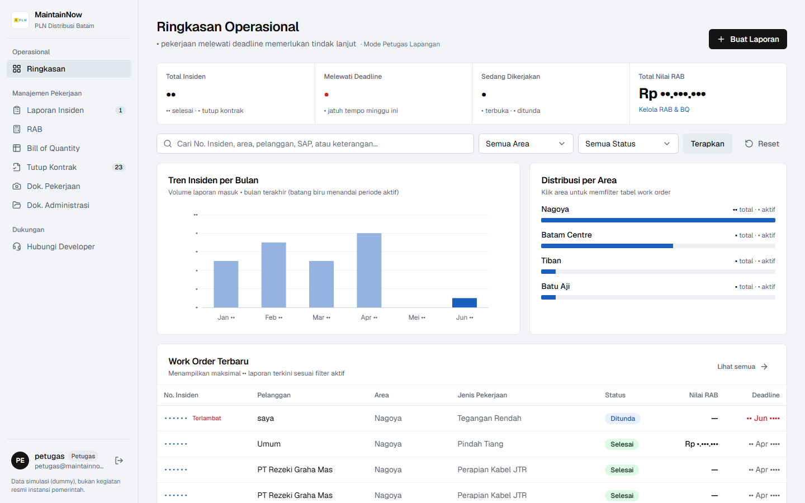
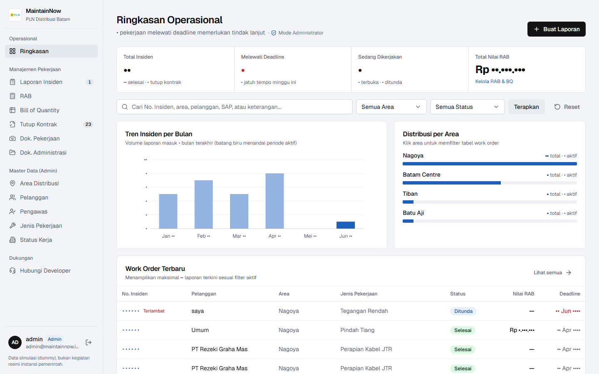
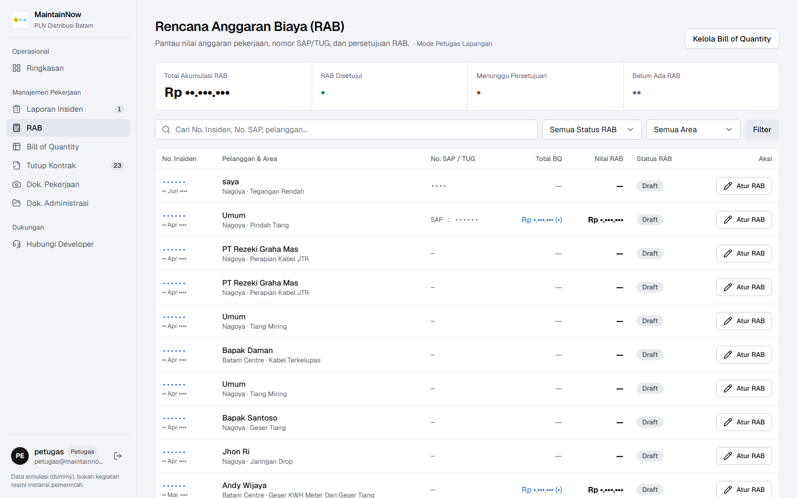
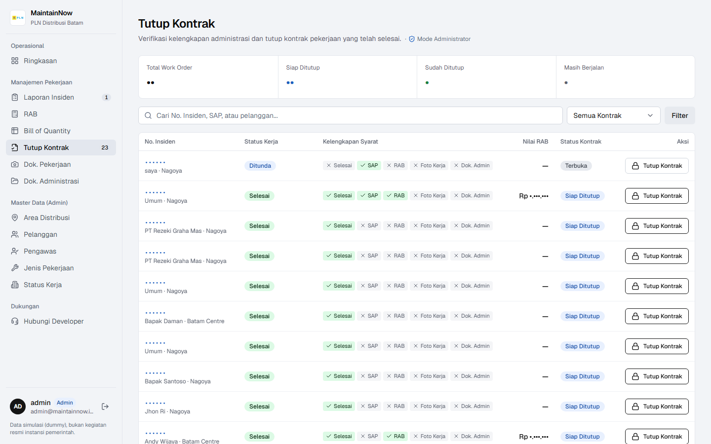
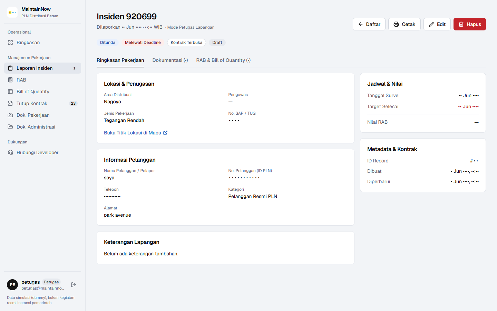
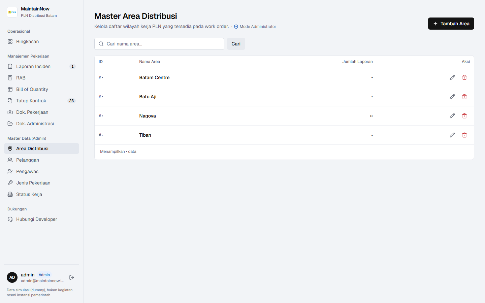

<p align="left">
  
</p>

# MaintainNow - Dashboard Monitoring Pemeliharaan Distribusi PLN

> [!IMPORTANT]
> **Disclaimer:** Seluruh data yang terdapat pada aplikasi, seeder basis data, tangkapan layar, serta video demonstrasi dalam repositori ini (termasuk nomor insiden, data pelanggan, nama pengawas, nilai RAB, BQ, dan lokasi) bersifat **dummy / simulasi pengembangan** semata dan **bukan merupakan data resmi maupun kegiatan yang memang direncanakan atau dilaksanakan oleh PT PLN (Persero) atau instansi pemerintah terkait**.

Sistem informasi manajemen work order, insiden jaringan distribusi, rencana anggaran biaya (RAB), Bill of Quantity (BQ), penutupan kontrak, serta arsip dokumentasi lapangan berbasis **Laravel 12**, **Inertia.js**, **React + TypeScript**, **Tailwind CSS v4**, dan **shadcn/ui** dengan pendekatan visual **Achromatic Ledger**.

---

## Pratinjau Antarmuka & Video Demo (POV User & Admin)

### Video Rekaman Alur Lengkap
- **POV User (Petugas Lapangan)**: [`docs/media/videos/pov-user.webm`](docs/media/videos/pov-user.webm)
- **POV Administrator**: [`docs/media/videos/pov-admin.webm`](docs/media/videos/pov-admin.webm)
- **Koleksi Lengkap (21 Screenshot)**: [`docs/media/screenshots/`](docs/media/screenshots/)

### Screenshot Utama

| POV Petugas — Ringkasan Operasional | POV Admin — Mode Administrator |
| :---: | :---: |
|  |  |

| Modul RAB & Pengajuan | Modul Tutup Kontrak (Admin) |
| :---: | :---: |
|  |  |

| Detail Laporan Insiden (Tabbed Sheet) | Master Data Area (Admin) |
| :---: | :---: |
|  |  |

---

## Fitur Utama

| Modul | Akses | Deskripsi |
| --- | --- | --- |
| **Ringkasan Operasional** (`/dashboard`) | Admin & Petugas | KPI status pekerjaan, indikator keterlambatan SLA, nilai total RAB, grafik tren insiden 6 bulan, distribusi beban per area, dan daftar work order terbaru. |
| **Laporan Insiden** (`/laporan`) | Admin & Petugas | CRUD lengkap laporan gangguan/pekerjaan, filter status dan area, pencarian lintas relasi, tautan Google Maps, serta unggah foto pekerjaan, foto administrasi, dan dokumen pendukung. |
| **Rencana Anggaran Biaya (RAB)** (`/rab`) | Admin & Petugas | Pengelolaan nilai RAB, nomor SAP/TUG, pengajuan status (`draft` / `diajukan`), dan persetujuan (`disetujui` oleh Admin). |
| **Bill of Quantity (BQ)** (`/bill-of-quantity`) | Admin & Petugas | Rincian item material, jasa, dan pekerjaan sipil per insiden dengan kalkulasi subtotal otomatis dan sinkronisasi satu klik ke nilai RAB laporan. |
| **Tutup Kontrak** (`/tutup-kontrak`) | Admin & Petugas | Daftar periksa 5 syarat kelengkapan administrasi (status selesai, nomor SAP, nilai RAB, foto pekerjaan, dokumen administrasi) serta proses tutup/buka kontrak oleh Admin. |
| **Dokumentasi Pekerjaan & Administrasi** (`/dokumentasi-pekerjaan`, `/dokumentasi-administrasi`) | Admin & Petugas | Galeri terpusat foto lapangan dan berkas administrasi dengan filter area/insiden, pratinjau lightbox, unduh, unggah langsung, dan hapus. |
| **Master Data** (`/areas`, `/pelanggans`, `/pengawas`, `/jenis_pekerjaan`, `/status`) | **Admin** | Pengelolaan Area Distribusi, Pelanggan PLN/Non-Pelanggan, Pengawas Lapangan, Jenis Pekerjaan, dan Status Kerja. |
| **Hubungi Developer** (`/contact`) | Publik / Auth | Formulir pelaporan kendala teknis & saran fitur yang tersimpan ke basis data dengan kotak masuk pembaruan status untuk Admin. |

---

## Peran Pengguna (Role)

1. **Administrator (`role: admin`)**
   - Akses penuh seluruh modul operasional, persetujuan RAB (`disetujui`), penutupan/pembukaan kembali kontrak, manajemen status kotak masuk dukungan, dan CRUD seluruh Master Data.
2. **Petugas Lapangan (`role: user`)**
   - Akses dashboard operasional, pembuatan/pembaruan laporan insiden, penyusunan Bill of Quantity, pengajuan RAB, pengunggahan dokumentasi lapangan/administrasi, serta pemantauan syarat tutup kontrak. Akses ke rute Master Data dan penutupan kontrak ditolak dengan HTTP `403`.

---

## Teknologi yang Digunakan

- **Backend**: PHP 8.2+, Laravel 12, Inertia.js Laravel (`inertiajs/inertia-laravel`)
- **Frontend**: React 19, TypeScript, `@inertiajs/react`, Tailwind CSS v4, Radix UI + **shadcn/ui**, Lucide Icons
- **Database**: MySQL (`pln_dashboard_monitoring` untuk lokal/produksi) & SQLite `:memory:` untuk pengujian PHPUnit
- **Pengujian & Kualitas Kode**: PHPUnit 11 + Xdebug Code Coverage, Laravel Pint, TypeScript (`tsc`), ESLint 9, Vite 7

---

## Struktur Proyek

```text
├── app/
│   ├── Http/
│   │   ├── Controllers/      # Controller Dashboard, Laporan, RAB, BQ, Tutup Kontrak, Dokumentasi, Master Data, Auth, Contact
│   │   └── Middleware/       # HandleInertiaRequests & EnsureAdmin
│   └── Models/               # User, Laporan, Area, Pelanggan, Pengawas, JenisPekerjaan, Status, Dokumen, BqItem, ContactMessage
├── database/
│   ├── migrations/           # Skema tabel & pembaruan kolom role, bq_items, tutup kontrak, contact_messages
│   └── seeders/              # UserSeeder, MasterDataSeeder, LaporanSeeder, BqSeeder
├── docs/
│   ├── ARSITEKTUR.md         # Arsitektur sistem, ERD Mermaid, dan matriks otorisasi
│   ├── PANDUAN_FITUR.md      # Panduan operasional Petugas & Admin
│   └── media/                # Screenshot (desktop & mobile) dan video POV User & Admin
├── resources/
│   ├── css/app.css           # Token desain Achromatic Ledger & Tailwind v4
│   ├── js/
│   │   ├── Layouts/          # AppLayout (Open Plane sidebar & mobile sheet)
│   │   ├── Pages/            # Halaman React TypeScript per modul
│   │   ├── components/ui/    # Komponen shadcn/ui (Button, Card, Table, Dialog, Select, Tabs, dll.)
│   │   └── lib/utils.ts      # Helper formatting Rupiah, tanggal Indonesia, dan classnames
│   └── views/                # Root template Inertia (app.blade.php) & halaman error HTTP
├── routes/web.php            # Definisi rute tamu, terautentikasi, dan khusus Admin
└── tests/
    ├── Unit/ModelTest.php
    └── Feature/              # AuthTest, DashboardAndLaporanTest, OperationalModulesTest, MasterDataTest
```

---

## Instalasi & Menjalankan Secara Lokal

1. **Instal dependensi PHP dan JavaScript:**
   ```bash
   composer install
   npm install
   ```

2. **Konfigurasi lingkungan (`.env`):**
   Pastikan layanan MySQL aktif dan sesuaikan `.env`:
   ```env
   DB_CONNECTION=mysql
   DB_HOST=127.0.0.1
   DB_PORT=3306
   DB_DATABASE=pln_dashboard_monitoring
   DB_USERNAME=root
   DB_PASSWORD=
   ```

3. **Migrasi, Seeder, Storage Link, dan Build Aset:**
   ```bash
   php artisan key:generate
   php artisan migrate --seed
   php artisan storage:link
   npm run build
   ```

4. **Jalankan server pengembangan:**
   ```bash
   php artisan serve
   ```
   Buka `http://127.0.0.1:8000` di peramban.

---

## Akun Demo Bawaan (Seeder)

| Peran | Nama Pengguna | Password |
| --- | --- | --- |
| **Administrator** | `admin` | `password123` |
| **Petugas Lapangan** | `petugas` | `password123` |

---

## Linter & Hasil Pengujian (Test Coverage)

Jalankan seluruh pemeriksaan kualitas kode dan pengujian otomatis dengan perintah berikut:

```bash
# Linter PHP (Laravel Pint)
php vendor/bin/pint --test

# Typecheck & Linter Frontend (TypeScript + ESLint)
npm run typecheck
npm run lint

# Build Produksi Vite
npm run build

# Pengujian PHPUnit dengan Laporan Cakupan Kode (Xdebug)
php -d zend_extension=php_xdebug.dll -d xdebug.mode=coverage vendor/phpunit/phpunit/phpunit --coverage-text
```

**Ringkasan Verifikasi Terakhir:**
- **Laravel Pint**: Lolos (`passed`)
- **TypeScript (`tsc --noEmit`) & ESLint**: Lolos tanpa error
- **Vite Production Build**: Berhasil (`public/build/manifest.json`)
- **PHPUnit + Xdebug Coverage**: **16 / 16 tests passed (157 assertions)** — **93.37% Line Coverage (1140 / 1221 lines)** dan **81.32% Method Coverage (74 / 91 methods)**.

---

## Dokumentasi Lanjutan

- [Arsitektur Sistem & Skema Basis Data](docs/ARSITEKTUR.md)
- [Panduan Penggunaan Fitur](docs/PANDUAN_FITUR.md)
- [Catatan Perubahan (Changelog)](CHANGELOG.md)
