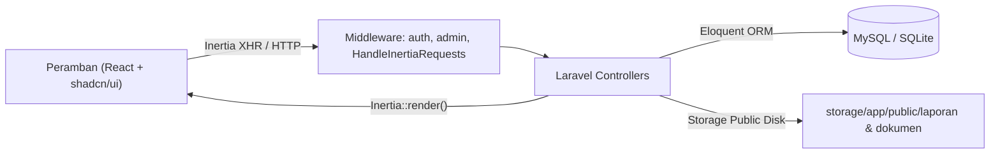
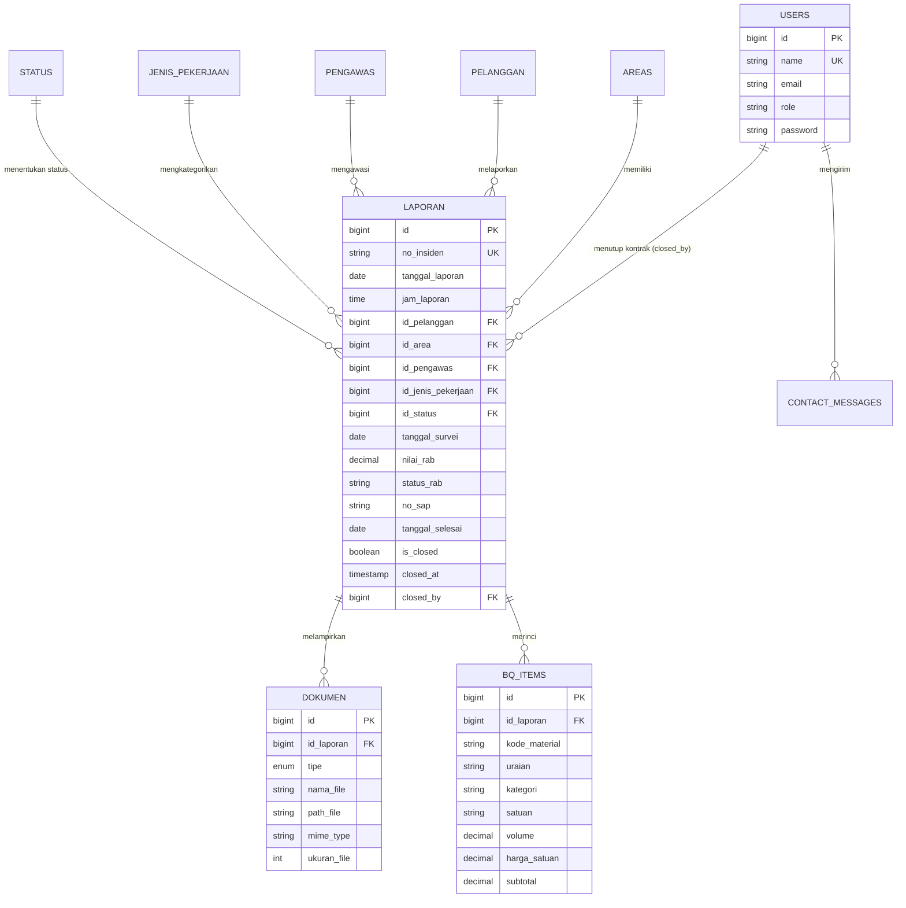

# Arsitektur Sistem & Skema Basis Data — MaintainNow

Dokumen ini menjelaskan arsitektur aplikasi, alur otorisasi berbasis peran, serta skema relasi basis data pada **MaintainNow**.

---

## 1. Arsitektur Aplikasi

MaintainNow menggunakan pola **Monolith Modern (Laravel 12 + Inertia.js + React TypeScript)**:

### Pembagian Direktori Utama

- `app/Http/Controllers/` — Logika bisnis dashboard, laporan, RAB, BQ, tutup kontrak, dokumentasi, master data, autentikasi, dan kontak.
- `app/Http/Middleware/` — `HandleInertiaRequests` (berbagi sesi user, flash message, ringkasan antrean navigasi) dan `EnsureAdmin` (proteksi rute administrator).
- `app/Models/` — Model Eloquent (`User`, `Laporan`, `Area`, `Pelanggan`, `Pengawas`, `JenisPekerjaan`, `Status`, `Dokumen`, `BqItem`, `ContactMessage`).
- `resources/js/Layouts/AppLayout.tsx` — Shell aplikasi (*Open Plane* Achromatic Ledger) dengan pemisahan navigasi Petugas dan Administrator.
- `resources/js/components/ui/` — Komponen primitif **shadcn/ui** berbasis Radix UI dan Tailwind CSS v4.
- `resources/js/Pages/` — Halaman React TypeScript untuk setiap modul.

---

## 2. Skema Relasi Basis Data (ERD)

---

## 3. Matriks Hak Akses (User vs Admin)

| Kemampuan | Petugas (`user`) | Administrator (`admin`) |
| --- | :---: | :---: |
| Ringkasan Operasional & Grafik | Ya | Ya |
| CRUD Laporan Insiden & Upload Berkas | Ya | Ya |
| Susun Item Bill of Quantity & Sinkron RAB | Ya | Ya |
| Ajukan RAB (`draft` / `diajukan`) | Ya | Ya |
| Setujui RAB (`disetujui`) | Tidak | Ya |
| Lihat Checklist Tutup Kontrak | Ya | Ya |
| Tutup & Buka Kembali Kontrak | Tidak | Ya |
| Kelola Dokumentasi Pekerjaan & Administrasi | Ya | Ya |
| CRUD Master Data (Area, Pelanggan, Pengawas, Jenis, Status) | Tidak (HTTP 403) | Ya |
| Ubah Status Kotak Masuk Dukungan | Tidak (HTTP 403) | Ya |
